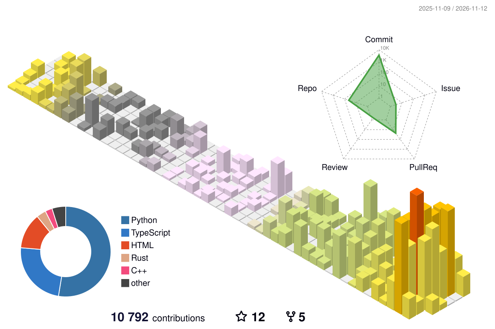
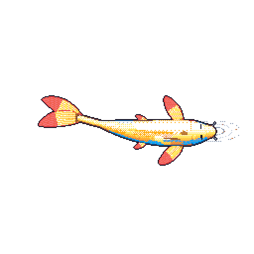

<h1 align="center">
  
</h1>

**ECE + CS-minor student at TIET · Embedded Systems & IoT**

I build embedded and IoT systems, from ESP32 firmware and sensor integration to PCB design, wireless networking, and dashboards. I am a founder at:

## Featured Projects

### Zephyr Station

An ESP32 environmental monitoring station with seven sensors/modules, live OLED readings, SD-card data logging, RTC timestamps, threshold alerts, and a web dashboard.

### Energy Consumption Pattern Analysis

A PCA and K-Means pipeline for exploring daily electricity-use patterns.

### Jolt Locator

An Arceus Labs team project: an ESP32 GPS compass that points toward the nearest energy-drink store, with true-north heading, an OLED display, and GPS-status indicators.

## Toolkit

- **Firmware & IoT:** C, C++, ESP32, Arduino, Wi-Fi, BLE, MQTT
- **Hardware:** sensor integration, PCB design with KiCad, prototyping
- **Data & analysis:** Python, OpenCV, PCA, K-Means, MATLAB
- **Digital design:** Verilog
- **Rust:** a small standard-library CLI that checks local image references in this README

## Contributions

<picture>
  <source
    media="(prefers-color-scheme: dark)"
    srcset="https://raw.githubusercontent.com/shaxntanu/shaxntanu/main/profile-3d-contrib/profile-night-green.svg"
  />
  
</picture>

In dark mode, each day's bar uses the primary language of the repo receiving the most commits that day. Bar height shows total contributions.

  

