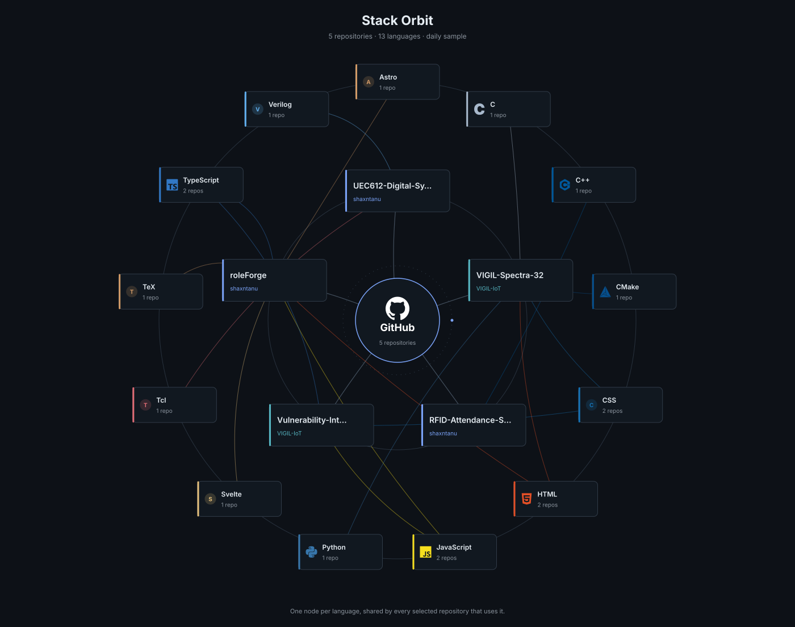

<h1 align="center">
  
</h1>

<strong>ECE + CS-minor student at TIET · Embedded Systems &amp; IoT</strong>

I build embedded and IoT systems, from ESP32 firmware and sensor integration to PCB design, wireless networking, and dashboards. I am a founder at:

  
  
   
  
  
  
  
  

<h2 align="center">Featured Projects</h2>

<table align="center">
  <thead>
    <tr>
      <th align="center">Project</th>
      <th align="center">About</th>
      <th align="center">Links</th>
    </tr>
  </thead>
  <tbody>
    <tr>
      <td align="center"><strong>Zephyr Station</strong></td>
      <td align="center">ESP32 environmental monitor with seven sensors, OLED readings, SD logging, RTC timestamps, alerts, and a web dashboard.</td>
      <td align="center"></td>
    </tr>
    <tr>
      <td align="center"><strong>Energy Consumption Analysis</strong></td>
      <td align="center">A PCA and K-Means pipeline for exploring daily electricity-use patterns.</td>
      <td align="center">
        
        
        
      </td>
    </tr>
    <tr>
      <td align="center"><strong>Jolt Locator</strong></td>
      <td align="center">An ESP32 GPS compass that points to the nearest energy-drink store, with true-north heading and an OLED display.</td>
      <td align="center"></td>
    </tr>
  </tbody>
</table>

<h2 align="center">Toolkit</h2>

<table align="center">
  <thead>
    <tr>
      <th align="center">Area</th>
      <th align="center">Tools and technologies</th>
    </tr>
  </thead>
  <tbody>
    <tr><td align="center"><strong>Firmware and IoT</strong></td><td align="center">C, C++, ESP32, Arduino, Wi-Fi, BLE, MQTT</td></tr>
    <tr><td align="center"><strong>Hardware</strong></td><td align="center">Sensor integration, PCB design with KiCad, prototyping</td></tr>
    <tr><td align="center"><strong>Data and analysis</strong></td><td align="center">Python, OpenCV, PCA, K-Means, MATLAB</td></tr>
    <tr><td align="center"><strong>Digital design</strong></td><td align="center">Verilog</td></tr>
    <tr><td align="center"><strong>Rust</strong></td><td align="center">README asset checker, Stack Orbit SVG generator</td></tr>
  </tbody>
</table>

<h2 align="center">Stack Orbit</h2>

  

Refreshes daily. Repositories using the same language connect to one shared node.

<h2 align="center">Contributions</h2>

  <picture>
    <source
      media="(prefers-color-scheme: dark)"
      srcset="https://raw.githubusercontent.com/shaxntanu/shaxntanu/main/profile-3d-contrib/profile-night-green.svg"
    />
    
  </picture>

In dark mode, each day's bar uses the primary language of the repo receiving the most commits that day. Bar height shows total contributions.

<h2 align="center">Git Koi</h2>

<a href="https://github.com/yalongwastaken/git-koi">Git Koi</a> is a Rust project that turns my public GitHub activity into an animated koi with language-based colors.

  

